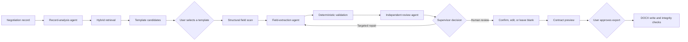
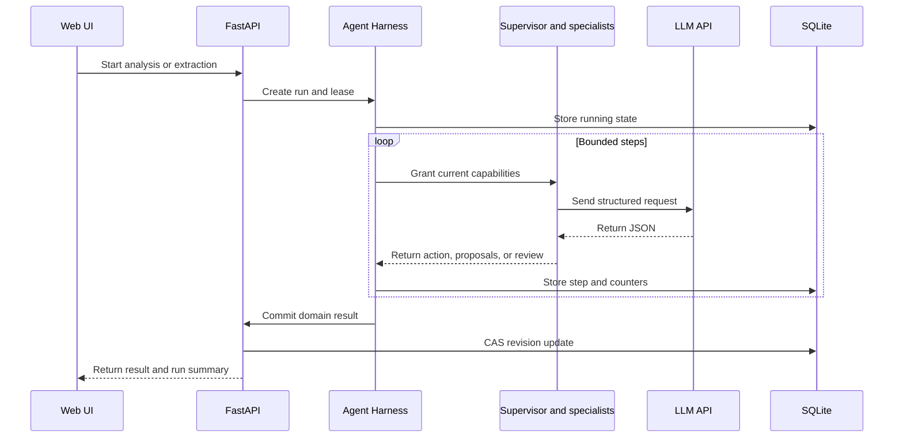
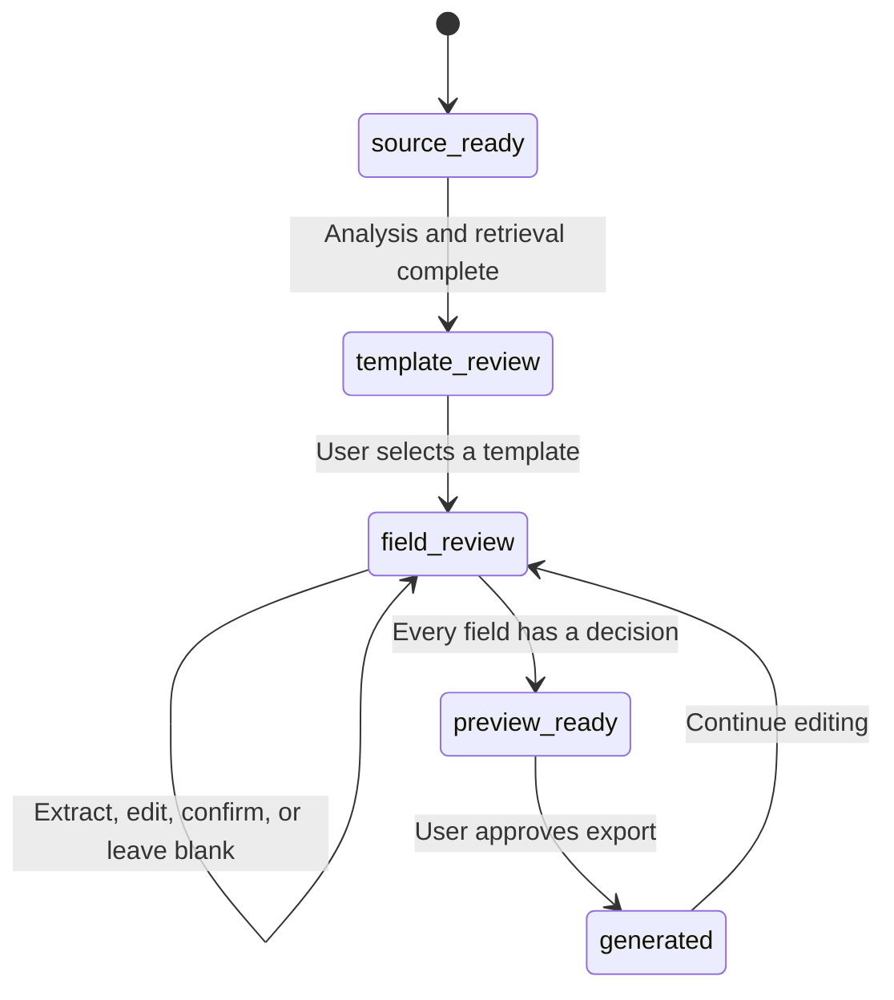

# ContractWeaver Guide

English | [简体中文](guide.zh-CN.md)

This guide covers the product workflow, agent collaboration, harness controls, contract-template processing, deployment, configuration, and main code paths.

## 1. Purpose

ContractWeaver extracts reviewable facts from negotiation records and places approved values into a user-selected Word template. It supports:

- turning chats or meeting minutes into a contract draft;
- finding suitable originals in a contract-template library;
- linking every proposed value to source evidence;
- handling missing facts, disagreements, and formatting issues in one review flow;
- exporting an editable DOCX based on the original layout.

Contract decisions remain with the user. Template selection, field approval, intentional blanks, and export all require user action.

## 2. End-to-end workflow



A workspace follows these stages:

1. Create a workspace and import the source record.
2. Analyze the transaction and retrieve templates.
3. Let the user inspect candidates and choose an original template.
4. Scan fillable positions and extract proposals in batches.
5. Validate evidence and types, then run an independent review.
6. Let the user confirm, edit, or temporarily leave unknown fields blank.
7. Build a preview and request export approval.
8. Generate a new file while preserving the original.

## 3. Agent team

| Role | Input | Output | Authority |
| --- | --- | --- | --- |
| Supervisor | Current phase, allowed actions, retrieval or review observations | Next action, target fields, short decision summary | Selects from server-granted actions |
| Record analyst | Line-numbered negotiation record | Contract type, agreements, disputes, missing facts, search intent | Cannot select a template |
| Field extractor | Record, short field IDs, type constraints, local template context | Proposed values, status, evidence, notes | Cannot approve or export |
| Independent reviewer | Proposals, evidence, and field context | Severity, issues, and repair guidance | Cannot approve fields |
| Coverage reviewer | Template field inventory and extraction results | Possible omissions, duplicates, and conflicts | Cannot write DOCX |

All roles use the same configured base model with separate instructions and request contexts. The default preset is `deepseek-flash`; another OpenAI-compatible Chat Completions service can be configured.

### Supervisor planning

The supervisor receives a limited action set for the current phase:

- Template phase: accept candidates, refine the query and search again, or ask the user for clarification.
- Field phase: accept the review, target problematic fields for repair, or hand the result to the user.
- Every phase: obey search, repair, request, step, input-size, and runtime budgets.

The defaults allow up to three searches per analysis and one targeted repair per field batch. Duplicate queries, invalid field IDs, and actions outside the capability set are rejected.

## 4. Harness

The harness applies one execution policy to every agent call.



Core controls:

- **Capability allowlist:** each step can invoke only the business actions opened for that phase.
- **Shared budgets:** parallel batches and retries share request, step, character, and time limits.
- **Run context:** `ContextVar` carries the active run and step identifiers.
- **Concurrency lease:** conflicting operations cannot run at the same time for one workspace.
- **Run journal:** SQLite stores recent status, actions, counters, and short summaries.
- **Commit ordering:** completion is published after the domain revision is stored successfully.
- **Interruption handling:** expired leases become interrupted runs and the user can retry the operation.

The harness exposes no shell, unrestricted file access, or general network tool. Models cannot select a template, approve fields, or generate a file for the user.

Main implementation files:

- `backend/app/agents/harness.py`
- `backend/app/observability.py`
- `backend/app/repositories/agent_runs.py`
- `backend/app/agents/supervisor.py`
- `backend/app/agents/negotiation_coordinator.py`
- `backend/app/agents/field_coordinator.py`

## 5. Prompts and structured output

Role instructions are versioned in `backend/app/agents/prompts.py`. They define:

- the meaning of every input section;
- how to separate agreements, rejected offers, and unresolved items;
- how short field IDs map to template context;
- formatting rules for money, dates, choices, and units;
- line-numbered source evidence requirements;
- JSON fields, enums, and failure states;
- the expected response when information is missing.

Responses pass through Pydantic schemas, short-ID mapping, source-substring checks, type validation, and independent review. The UI shows concise decision summaries and execution steps while keeping provider-internal reasoning private.

## 6. Template retrieval

Recommendations combine several local retrieval channels:

1. BM25 over template titles;
2. BM25 over business keywords;
3. exact title and identifier matches;
4. an optional local embedding channel;
5. Reciprocal Rank Fusion for final ranking.

An explicit template title or identifier in the source receives strong exact-match priority. The service builds a candidate pool, applies structural safety checks, and returns up to five suggestions. Users can always search, preview, download, and select from the full library.

The optional vector channel requires a local embedding model and matching FAISS index. The default setup uses lexical retrieval and has no vector-database dependency.

Main implementation files:

- `backend/app/services/template_retrieval.py`
- `backend/app/services/contract_templates.py`
- `backend/resources/contracts/`

## 7. Filling original Word templates

The original DOCX supplies the layout. Processing has four stages.

### 7.1 Scan

`template_slots.py` traverses body text, tables, headers, footers, and supported text structures. It locates underlines, blank runs, date cells, table spaces, and supported choices. Every position receives a stable locator and nearby context.

### 7.2 Extract

Fields are sent to the model in batches. Each request includes:

- line-numbered meeting minutes;
- short IDs for the current batch;
- type and formatting constraints;
- fixed text around each location;
- table row and column context;
- a strict JSON response contract.

The DOCX binary is kept on the server.

### 7.3 Human review

Each proposal includes source evidence. The user can confirm it, edit it, add a note, or leave it blank. Bulk blank handling applies only to unresolved empty fields and preserves reviewed values.

### 7.4 Write and verify

During export, the engine updates XML text nodes through stored locators and creates a new DOCX. It then checks expected text, drawing structure, and media resources. Unsupported structures are blocked or flagged for visual review.

Main implementation files:

- `backend/app/documents/template_slots.py`
- `backend/app/documents/slot_constraints.py`
- `backend/app/documents/word_text.py`
- `backend/app/documents/word_compatibility.py`
- `backend/app/documents/word_integrity.py`

## 8. Workspace states and human gates



Workspace updates use compare-and-swap revisions, so stale pages cannot overwrite newer work. A template or field-engine change requires a fresh template selection and review.

The progress panel reports:

- the current phase and next action;
- processed field batches;
- actual model HTTP request counts;
- status for each agent step;
- supervisor actions and target counts;
- failure, partial-result, and fallback messages.

## 9. Configuration

Backend secrets belong in `backend/.env`. Create it from the example:

```bash
cp backend/.env.example backend/.env
```

Windows CMD:

```bat
copy backend\.env.example backend\.env
```

Main settings:

| Variable | Purpose | Default |
| --- | --- | --- |
| `LAW_LLM_API_KEY` | Model-service key | empty |
| `LAW_LLM_BASE_URL` | OpenAI-compatible API base | `https://api.deepseek.com` |
| `LAW_LLM_MODEL` | Model identifier | `deepseek-flash` |
| `LAW_LLM_JSON_MODE` | JSON response mode | `json_object` |
| `LAW_LLM_THINKING_MODE` | Provider reasoning mode | `disabled` |
| `LAW_FIELDS_PER_BATCH` | Fields per extraction batch | `30` |
| `LAW_AGENT_PARALLELISM` | Agent concurrency | `2` |
| `LAW_SUPERVISOR_MAX_SEARCHES` | Search limit per analysis | `3` |
| `LAW_SUPERVISOR_MAX_REPAIRS` | Repair limit per batch | `1` |
| `LAW_HARNESS_MAX_REQUESTS` | Request budget per run | `512` |
| `LAW_HARNESS_TIMEOUT_SECONDS` | Runtime budget in seconds | `3600` |

Frontend configuration is public:

```ini
VITE_API_BASE_URL=/api/v1
VITE_DEV_API_TARGET=http://127.0.0.1:8000
```

API keys must stay out of every `VITE_` variable.

## 10. Running locally

### Windows 11

Install Python 3.11+ and Node.js 20+, then check `python --version`, `node --version`, and `npm --version` in a new terminal. Run these commands from the repository root, using separate terminals for the two start scripts. Configure `backend/.env` as described in section 9 before using automatic analysis. Setup preserves an existing configuration file.

```bat
scripts\setup.bat
scripts\start-backend.bat
scripts\start-frontend.bat
```

The two start scripts use separate terminal sessions. Stop the project with:

```bat
scripts\stop-project.bat
```

To remove the project virtual environment, frontend dependencies, and caches as well:

```bat
scripts\stop-and-clean.bat
```

### Linux and macOS

```bash
./scripts/setup.sh
./scripts/start-backend.sh
./scripts/start-frontend.sh
```

### Docker

Prepare a working Docker Engine/Desktop and Compose, configure `backend/.env`, then run:

```bash
docker compose up --build -d
docker compose ps
docker compose logs -f
docker compose down
```

Open `http://127.0.0.1:8080`. Backend configuration is mounted as a file secret. Container data uses a named volume, separate from local `backend/data/`. After changing model settings, run `docker compose up -d --force-recreate`. Back up the database and generated documents together; `docker compose down -v` deletes the data volume.

### Shutdown and retained data

On Windows, `stop-project.bat` stops project services and related child processes and clears temporary caches. `stop-and-clean.bat` also removes the project virtual environment, frontend dependencies, and build output; run setup again before restarting. Both scripts preserve sources, private configuration, templates, databases, and generated documents. On Linux/macOS, use Ctrl+C in each service terminal; use `docker compose down` for containers.

The default database is `backend/data/contractweaver.db`. An existing `lawreasoner.db` is reused when the new database does not exist. Override this with `LAW_DATABASE_PATH`. Relative configuration paths resolve against the backend directory. Check custom absolute paths after renaming the project directory. Template or field-engine changes require selecting the template and reviewing fields again.

### Troubleshooting

| Symptom | Check |
| --- | --- |
| UI loads but API calls fail | Backend terminal, port 8000, and `VITE_DEV_API_TARGET` |
| Model authentication fails | Backend `LAW_LLM_API_KEY` and provider permissions |
| Model endpoint returns 404 | Base URL and model name; omit `/chat/completions` from the base URL |
| Rate limit or insufficient credit | Provider balance and limits; reduce `LAW_AGENT_PARALLELISM` if needed |
| Timeout or truncated output | Network, `LAW_REQUEST_TIMEOUT`, batch size, and output token limit |
| Configuration change has no effect | Restart the backend; process environment variables override `.env` |
| Empty template library | `LAW_RESOURCES_DIR` and custom absolute paths |
| Missing test dependencies | Install `backend/requirements-dev.txt`; run `npm ci` for the frontend |

The health endpoint reports `model_configured=true` when required settings are present. Verify live connectivity with the manually invoked, billable probe in section 13.

## 11. API overview

Business routes use the `/api/v1` prefix.

| Method and path | Purpose |
| --- | --- |
| `POST /auth/register` | Register with email |
| `POST /auth/login` | Sign in |
| `POST /sources/parse` | Parse an uploaded source record |
| `POST /workspaces` | Create a contract workspace |
| `POST /workspaces/{id}/analyze` | Analyze the record and retrieve templates |
| `POST /workspaces/{id}/template` | Save the user's template choice |
| `POST /workspaces/{id}/extract` | Extract, validate, and review fields |
| `PATCH /workspaces/{id}/fields` | Save human review decisions |
| `GET /workspaces/{id}/preview` | Build a contract preview |
| `POST /workspaces/{id}/generate` | Generate DOCX |
| `GET /workspaces/{id}/runs` | Read agent run history |
| `GET /contracts/templates` | Browse the template library |

After local startup, the full OpenAPI page is available at `http://127.0.0.1:8000/docs`.

## 12. Agent and Harness implementation reading order

Follow the [Agent/Harness source-reading guide (Chinese)](code-reading-guide.zh-CN.md). It covers role assembly, structured model requests, supervisor decisions, bounded coordination loops, runtime budgets, context propagation, execution leases, and run history. Application UI, contract rules, and Word processing are outside that reading route.

## 13. Checks and tests

Backend (install `backend/requirements-dev.txt` first):

```bash
cd backend
python -m unittest discover -s tests -v
python -m ruff check app tests
python -m app.cli.check_comments
```

Frontend:

```bash
cd frontend
npm test
npm run build
```

Repository-wide checks on Windows:

```powershell
./scripts/check.ps1
```

Template audit:

```bash
cd backend
python -m app.cli.audit_templates --summary --progress
```

The live model check sends billable API traffic. Run it with a dedicated test key:

```bash
cd backend
python -m app.cli.check_llm
```

## 14. Examples and acceptance checks

`examples/meeting-minutes-custody.md` contains a fictional custody-contract meeting with an explicit template name, a final fee, a withdrawn offer, missing facts, and unresolved clauses. It is useful for checking:

- exact retrieval of `保管合同 GF—2000—0801`;
- retention of the final agreement and removal of withdrawn offers;
- source evidence for parties, amount, and term;
- empty values for unknown accounts and dispute resolution;
- bulk blank handling followed by continued editing.

`examples/meeting-minutes-equipment-purchase.md` demonstrates industrial-goods template retrieval and field extraction.

## 15. Known limits

- Template scanning depends on Word structure and may miss visual blanks, complex drawings, appendices, or layout semantics.
- The text preview groups paragraphs and tables; the downloaded Word file remains the final layout reference.
- Models can omit facts, confuse roles, or return invalid formats, so human review is part of generation.
- Run journals support status inspection and failure diagnosis. The current runtime has no durable background queue or arbitrary-node resume.
- Retrieval narrows the candidate set; users decide which template applies.
- Production deployment needs HTTPS, access control, backups, auditing, rate limits, and monitoring.
- Formal execution requires appropriate business, finance, and legal review.
