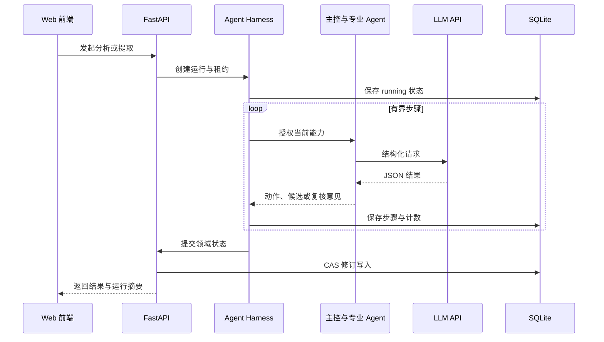
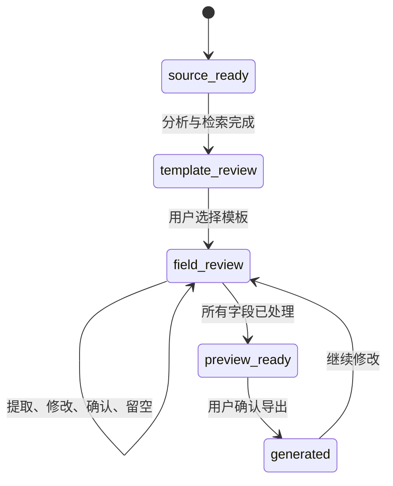

# ContractWeaver 完整指南

[English](guide.en.md) | 简体中文

本文面向使用者、开发者和项目评审者，介绍系统流程、Agent 协作、Harness 约束、合同模板处理、部署配置与代码入口。

## 1. 产品目标

ContractWeaver 从合同协商记录中提取可核对的信息，并填入用户选定的 Word 模板。系统保留人工关卡，适合以下场景：

- 将聊天记录或会议纪要整理为合同草稿；
- 从模板库中查找与交易类型匹配的原件；
- 为每个候选值保留原文依据；
- 集中处理缺失信息、分歧和格式问题；
- 在 Word 原有结构上生成可继续编辑的 DOCX。

系统不会代替签署人作出合同决定。模板选择、字段确认、明确留空和导出均由用户完成。

## 2. 端到端流程


一次任务经历以下阶段：

1. 创建任务并导入记录；
2. 分析交易信息并检索模板；
3. 用户查看候选，选择原始模板；
4. 系统扫描模板位置，分批提取候选值；
5. 校验器和复核 Agent 检查证据、类型与冲突；
6. 用户处理字段，未知内容可以批量暂留空；
7. 用户检查预览并确认导出；
8. 文档引擎生成新文件，原件保持不变。

## 3. Agent 团队

| 角色 | 输入 | 输出 | 权限 |
| --- | --- | --- | --- |
| 主控 Agent | 当前阶段、可用动作、检索或复核结果 | 下一动作、目标字段、简短决策摘要 | 只能选择服务端授予的动作 |
| 记录分析 Agent | 带行号的协商记录 | 合同类型、共识、分歧、缺失信息、检索意图 | 无模板选择权 |
| 字段提取 Agent | 记录、字段短编号、类型约束、局部模板上下文 | 候选值、状态、证据和说明 | 无确认与导出权 |
| 独立复核 Agent | 候选字段、证据、上下文 | 问题级别、问题描述、修正建议 | 无字段批准权 |
| 全合同覆盖 Agent | 模板字段清单与提取结果 | 可能遗漏、重复或冲突的位置 | 无 Word 写入权 |

这些角色共用同一套模型配置，各自拥有独立任务说明和请求上下文。默认模型为 `deepseek-flash`，可以替换为兼容 OpenAI Chat Completions 接口的服务。

### 主控如何规划

主控每次只处理当前阶段允许的动作：

- 模板阶段：接受候选、调整查询后再次检索、向用户提问；
- 字段阶段：接受复核结果、选择问题字段进行修正、结束自动处理并交给用户；
- 任何阶段：受到搜索次数、修正轮数、请求数、步骤数、输入大小和总运行时间限制。

默认每次模板分析最多检索三轮，每批字段最多修正一轮。重复查询、非法字段编号和超出能力清单的动作会被拒绝。

## 4. Harness

Harness 为所有 Agent 调用提供统一执行边界。



主要机制：

- **能力白名单**：每个步骤只能调用当前开放的业务能力；
- **共享预算**：并行批次和重试共享请求、步骤、字符和时间预算；
- **运行上下文**：`ContextVar` 传递运行编号与步骤信息；
- **并发租约**：同一任务避免同时执行两次冲突操作；
- **运行日志**：SQLite 保存最近运行的状态、动作、计数和简短摘要；
- **提交顺序**：领域状态成功写入后，前端才收到完成事件；
- **中断处理**：过期租约会标记为中断，用户可以重新执行当前操作。

Harness 不开放 Shell、任意文件访问或自由网络工具。模型也无法选择模板、替用户确认字段或直接生成文件。

关键实现：

- `backend/app/agents/harness.py`
- `backend/app/observability.py`
- `backend/app/repositories/agent_runs.py`
- `backend/app/agents/supervisor.py`
- `backend/app/agents/negotiation_coordinator.py`
- `backend/app/agents/field_coordinator.py`

## 5. Prompt 与结构化输出

所有角色的任务说明集中在 `backend/app/agents/prompts.py`，内容包括：

- 输入各部分的含义；
- 共识、被否决方案、未决事项的区分规则；
- 字段短编号和模板上下文的使用方式；
- 金额、日期、选项和单位的格式要求；
- 证据必须来自带行号原文的要求；
- JSON 字段、枚举值和失败状态；
- 信息不足时的处理方式。

模型输出会经过 Pydantic Schema、短编号映射、证据原文匹配、字段类型校验和复核 Agent 检查。用户界面展示简短决策摘要和步骤记录，不展示服务商内部推理内容。

## 6. 模板检索

模板推荐结合多路本地检索：

1. 模板名称 BM25；
2. 业务关键词 BM25；
3. 完整名称与编号匹配；
4. 可选的本地向量召回；
5. Reciprocal Rank Fusion 合并排序。

用户在记录中明确提到模板名称或编号时，完整匹配会获得更高优先级。系统先建立候选池，再进行结构安全检查，最终返回最多五份候选。模板库页面始终允许搜索、预览、下载和手动选择。

可选向量通道需要配置本地 embedding 模型路径与对应索引。默认配置依赖词法检索，无需向量数据库。

关键实现：

- `backend/app/services/template_retrieval.py`
- `backend/app/services/contract_templates.py`
- `backend/resources/contracts/`

## 7. 原始 Word 模板如何填写

系统使用原始 DOCX 作为排版基础，处理过程分为四步。

### 7.1 扫描

`template_slots.py` 遍历正文、表格、页眉页脚和可支持的文本结构，识别下划线、连续空白、日期分格、表格空位与选项。每个位置获得稳定定位信息和局部上下文。

### 7.2 提取

系统将字段分批发送给模型。请求包含：

- 带行号会议纪要；
- 当前批次短编号；
- 字段类型与格式约束；
- 位置附近的固定文字；
- 表格行列信息；
- 明确的 JSON 输出契约。

DOCX 二进制文件不会直接发送给模型。

### 7.3 人工审核

候选值保留原文依据。用户可以确认、修改、写入备注或暂留空。批量暂留空只处理当前未知且尚未确认的字段，已经填写的内容保持原状态。

### 7.4 写回与检查

生成时，文档引擎按定位信息修改 XML 文本节点并创建新 DOCX。随后检查预期文字、图形结构和媒体资源。复杂结构会触发拦截或视觉复核提示。

关键实现：

- `backend/app/documents/template_slots.py`
- `backend/app/documents/slot_constraints.py`
- `backend/app/documents/word_text.py`
- `backend/app/documents/word_compatibility.py`
- `backend/app/documents/word_integrity.py`

## 8. 任务状态与人工关卡



状态修订使用 CAS 检查，旧页面提交的过期版本会被拒绝。模板文件或字段引擎发生变化时，任务需要重新选择模板并审核字段。

进度区域显示：

- 当前阶段与下一步；
- 已处理批次数；
- 实际模型 HTTP 请求计数；
- 每个 Agent 的步骤状态；
- 主控选择的动作和目标字段数；
- 失败、部分完成和降级提示。

## 9. 配置

后端密钥配置位于 `backend/.env`。先复制示例：

```bash
cp backend/.env.example backend/.env
```

Windows CMD：

```bat
copy backend\.env.example backend\.env
```

核心设置：

| 配置项 | 用途 | 默认值 |
| --- | --- | --- |
| `LAW_LLM_API_KEY` | 模型服务密钥 | 空 |
| `LAW_LLM_BASE_URL` | OpenAI 兼容 API 基地址 | `https://api.deepseek.com` |
| `LAW_LLM_MODEL` | 模型名称 | `deepseek-flash` |
| `LAW_LLM_JSON_MODE` | JSON 输出模式 | `json_object` |
| `LAW_LLM_THINKING_MODE` | 服务商推理模式 | `disabled` |
| `LAW_FIELDS_PER_BATCH` | 每批字段数 | `30` |
| `LAW_AGENT_PARALLELISM` | Agent 并发数 | `2` |
| `LAW_SUPERVISOR_MAX_SEARCHES` | 单次分析最大检索轮数 | `3` |
| `LAW_SUPERVISOR_MAX_REPAIRS` | 每批最大修正轮数 | `1` |
| `LAW_HARNESS_MAX_REQUESTS` | 单次运行请求预算 | `512` |
| `LAW_HARNESS_TIMEOUT_SECONDS` | 单次运行时间预算 | `3600` |

前端只接受公开配置：

```ini
VITE_API_BASE_URL=/api/v1
VITE_DEV_API_TARGET=http://127.0.0.1:8000
```

模型密钥不得写入任何 `VITE_` 变量。

## 10. 本地运行

### Windows 11

先安装 Python 3.11+ 和 Node.js 20+，重新打开终端并检查 `python --version`、`node --version`、`npm --version`。以下命令均从项目根目录执行，两个启动脚本分别在两个终端运行。`setup.bat` 安装依赖并保留已有配置；如 `backend/.env` 尚未生成，按第 9 节复制示例，填入密钥后再使用自动分析。

```bat
scripts\setup.bat
scripts\start-backend.bat
scripts\start-frontend.bat
```

两个启动脚本分别占用终端。结束后运行：

```bat
scripts\stop-project.bat
```

需要同时删除项目虚拟环境、前端依赖和缓存时运行：

```bat
scripts\stop-and-clean.bat
```

### Linux 与 macOS

```bash
./scripts/setup.sh
./scripts/start-backend.sh
./scripts/start-frontend.sh
```

### Docker

准备可运行的 Docker Engine/Desktop 与 Compose，按第 9 节配置 `backend/.env`。在项目根目录执行：

```bash
docker compose up --build -d
docker compose ps
docker compose logs -f
docker compose down
```

默认访问 `http://127.0.0.1:8080`。后端配置通过文件型 secret 挂载；数据保存在命名卷，与本地 `backend/data/` 分开。修改模型配置后运行 `docker compose up -d --force-recreate`。备份应同时包含数据库和生成合同，`docker compose down -v` 会删除数据卷。

### 停止、数据与环境保留

Windows 的 `stop-project.bat` 停止本项目服务及关联子进程并清理临时缓存；`stop-and-clean.bat` 还删除项目虚拟环境、前端依赖与构建产物。清理后再次运行前需执行 `setup.bat`。两个脚本保留源码、私有配置、原始模板、数据库与生成合同。Linux/macOS 在各启动终端按 Ctrl+C；容器使用 `docker compose down`。

默认数据库为 `backend/data/contractweaver.db`；存在旧 `lawreasoner.db` 且新库尚未创建时会沿用旧库。`LAW_DATABASE_PATH` 可显式覆盖。配置中的相对路径以后端目录解析，项目根目录改名后应检查自定义绝对路径。模板或字段引擎更新后，旧任务需要重新选择模板并审核。

### 常见问题

| 现象 | 处理方式 |
| --- | --- |
| 前端打开但 API 请求失败 | 检查后端终端、8000 端口与 `VITE_DEV_API_TARGET` |
| 模型认证失败 | 检查后端 `LAW_LLM_API_KEY` 及服务商权限 |
| 模型接口返回 404 | 检查基础地址和模型名，基础地址不追加 `/chat/completions` |
| 429、额度不足 | 检查服务商余额与限流，适当降低 `LAW_AGENT_PARALLELISM` |
| 超时或输出截断 | 检查网络、`LAW_REQUEST_TIMEOUT`，减少每批字段数或调整输出长度 |
| 修改配置后仍使用旧值 | 重启后端；进程环境变量优先于 `.env` |
| 模板库为空 | 检查 `LAW_RESOURCES_DIR` 和目录改名后的绝对路径 |
| 测试缺少模块 | 安装 `backend/requirements-dev.txt`；前端执行 `npm ci` |

健康接口的 `model_configured=true` 表示必填配置齐全。真实连通性需手工运行第 12 节探针；探针会产生模型请求费用。

## 11. API 概览

所有业务接口使用 `/api/v1` 前缀。

| 方法与路径 | 功能 |
| --- | --- |
| `POST /auth/register` | 邮箱注册 |
| `POST /auth/login` | 登录 |
| `POST /sources/parse` | 解析上传记录 |
| `POST /workspaces` | 创建合同任务 |
| `POST /workspaces/{id}/analyze` | 分析记录并检索模板 |
| `POST /workspaces/{id}/template` | 保存用户选择的模板 |
| `POST /workspaces/{id}/extract` | 提取、校验和复核字段 |
| `PATCH /workspaces/{id}/fields` | 保存人工审核结果 |
| `GET /workspaces/{id}/preview` | 获取合同内容预览 |
| `POST /workspaces/{id}/generate` | 生成 DOCX |
| `GET /workspaces/{id}/runs` | 查看 Agent 运行记录 |
| `GET /contracts/templates` | 浏览模板库 |

本地启动后，可在 `http://127.0.0.1:8000/docs` 查看完整 OpenAPI 页面。

## 12. 检查与测试

### 注释层级

注释深度按模块复杂度确定：

- Agent、Harness、模板检索、字段校验和 Word 写入需要说明输入输出、状态变化、约束条件与失败处理；
- 登录注册、普通接口封装和简单页面函数使用一行职责说明；
- 变量名和代码已经能够清楚表达含义时，不重复翻译代码；
- Prompt 中的模型边界、界面中的风险提示属于产品逻辑，应保留准确、直接的约束表达。

项目使用 `python -m app.cli.check_comments` 和前端测试脚本检查注释是否缺失。自动检查只负责覆盖率，注释内容仍以清晰、准确和便于维护为准。

### 测试命令

`backend/tests/`、前端各 `__tests__/` 目录及 `frontend/vitest.config.js` 都是项目源码的一部分，应提交到 GitHub。它们用于复现功能边界、验证重构没有破坏行为，也能让贡献者运行同一套检查。测试生成的缓存、覆盖率报告、虚拟环境、`node_modules` 和构建产物不提交。

后端（先安装 `backend/requirements-dev.txt`）：

```bash
cd backend
python -m unittest discover -s tests -v
python -m ruff check app tests
python -m app.cli.check_comments
```

前端：

```bash
cd frontend
npm test
npm run build
```

根目录统一检查：

```powershell
./scripts/check.ps1
```

模板审计：

```bash
cd backend
python -m app.cli.audit_templates --summary --progress
```

真实模型连通性检查会产生 API 请求和费用，请在准备好独立测试密钥后执行：

```bash
cd backend
python -m app.cli.check_llm
```

## 13. 示例与验收

`examples/meeting-minutes-custody.md` 提供保管合同会议纪要，包含明确合同名称、最终费用、被撤回报价、缺失信息和未决条款。它适合检查以下行为：

- 准确命中《保管合同 GF—2000—0801》；
- 保留最终共识，排除已撤回报价；
- 为金额、期限和当事人信息提供原文依据；
- 将账号、争议解决等未知信息保持为空；
- 允许用户批量暂留空并继续完善草稿。

`examples/meeting-minutes-equipment-purchase.md` 用于工业品买卖模板检索和字段提取演示。

## 14. 已知边界

- 模板扫描依赖 Word 结构，无法覆盖所有视觉空白、复杂绘图、附件和排版语义；
- 文字预览按段落和表格展示，最终版面以下载后的 Word 文件为准；
- 模型可能遗漏事实、混淆角色或产生错误格式，人工审核属于生成流程的一部分；
- 运行日志支持状态追踪和失败定位，当前没有持久后台队列和任意节点自动续跑；
- 检索排序提供候选范围，最终适用模板由用户判断；
- 正式部署需要配置 HTTPS、访问控制、备份、审计、限流和监控；
- 正式签署前应完成业务、财务与法律审核。
